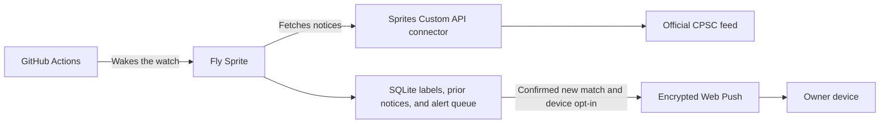

# Reacalcul

**A recall can change after you check it. Reacalcul remembers your fridge’s exact serial and alerts you if a later CPSC notice adds it.**

[](https://github.com/Agozie180/reacalcul/actions/workflows/deploy.yml) [](LICENSE)

| Open | What you can verify |
|---|---|
| [Live recall replay](https://reacalcul-b623b.sprites.app/?alert=example) | Compare two serials on the same model, then send a real example to your device. |
| [Run locally as a judge](judge.md) | Copy-paste setup for Windows, macOS, and Linux, with a screenshot of the expected result. |
| [90-second demo video](https://github.com/Agozie180/reacalcul/releases/download/hacksgiving-2026/reacalcul-hacksgiving-demo.mp4) · [Walkthrough and submission copy](DEMO.md) | The delivery receipt, the exact rule that triggered it, and the serial that stays outside. |
| [Live Sprite health](https://reacalcul-b623b.sprites.app/healthz) · [Deployment runs](https://github.com/Agozie180/reacalcul/actions/workflows/deploy.yml) | The release SHA and the CPSC connector import. |
| [Fly.io Hacksgiving 2026](https://fly.io/hacksgiving/) | Personal agent on Sprites with a connector. Targeting the $2,500 Grand Prize. |

## What did you build?

The January 2026 Frigidaire recall expansion added about **330,000 minifridges**. An owner who checked the July notice could have an old answer for the same fridge. Reacalcul keeps the label, checks the CPSC feed, and sends an opt-in device notification when an official change newly covers that exact serial. The alert opens the source and the manufacturer's refund instructions when the notice provides them. [July 2025 notice](https://www.cpsc.gov/Recalls/2025/Curtis-International-Recalls-Frigidaire-brand-Minifridges-Due-to-Fire-and-Burn-Hazards-More-Than-700-000-Reported-in-Property-Damage) · [January 2026 expansion](https://www.cpsc.gov/Recalls/2026/Curtis-International-Expands-Recall-of-Frigidaire-brand-Minifridges-Due-to-Fire-and-Burn-Hazards)

## Try it in 30 seconds

1. [Open the replay](https://reacalcul-b623b.sprites.app/?alert=example). Model `EFMIS121`, serial `A2210`, becomes newly covered. On the same model, `A2401` falls outside the January range.
2. Select **Send example to this device** and allow notifications. The historical sample goes through the same encrypted Web Push transport as a live alert. Open it to see the CPSC quote and refund link.
3. To start a live watch, save your own label and select **Enable device alerts**. The browser keeps its subscription after the tab closes.

## How it works



| Integration | What it does and where to check |
|---|---|
| Fly.io Sprites | Hosts the app and keeps saved labels, the last feed snapshot, and the delivery queue across releases. [Deploy script](scripts/deploy.py) |
| Sprites Custom API connector | Imports the official notice identities during deploy and fetches the live CPSC feed for subsequent scans. [Live health](https://reacalcul-b623b.sprites.app/healthz) · [Feed import and watch](app.py) |
| Web Push | Delivers the labeled example and real alerts through the same encrypted transport. [Sender](watch_push.py) · [Browser worker](sw.js) |

## When an alert can fire

| Decision | Evidence |
|---|---|
| The saved `EFMIS121 / A2210` becomes eligible when the range `A2001–A2310` appears. `A2401` stays outside. | [Live replay](https://reacalcul-b623b.sprites.app/?alert=example) · [Delivery and retry test](tests/test_push.py) |
| A saved label receives alerts after device opt-in. A serial already covered by the previous feed receives no new alert. | [Queue logic](watch_push.py) · [Same-notice edit test](tests/test_push.py) |
| When the previous scope is ambiguous, the watch links to the official notice for review. A later parsed range alone is insufficient to send a newly-covered alert. | [Ambiguous-scope regression test](tests/test_push.py) |

## Reproduce the evidence

| Check | Evidence | Command |
|---|---|---|
| Live replay and connector | 3/3 calls per serial reproduced the two outcomes, the exact CPSC quote, and the sample refund link. The replay left the watch empty. | `python3 scripts/verify_demo.py` |
| Matching and delivery | Six automated tests cover saved-label matching, duplicate suppression, retry, ambiguous prior scope, and decryption of the Web Push payload. | `python3 -m unittest discover -s tests -v` |

The live verifier uses the Python standard library. One six-call run measured a **0.52 s median** and a **0.83 s maximum** for replay API round trips. The script prints the timings for your machine. Device notification delivery has its own browser and push-provider latency.

## Scope and limitations

- The live watch covers the U.S. Curtis International Frigidaire minifridge recall series. It stores one model and serial per browser. The historical sample labels are illustrative. The CPSC notices and January unit count are real.
- The first successful scan establishes the baseline. The hourly job wakes the Sprite to check for queued work, and the official feed is fetched on roughly a daily cadence. New formats can require manual review. The official notice is the source of truth for coverage and remedies.
- Device alerts require browser permission and a Web Push-capable browser. On iOS or iPadOS, open the site from the Home Screen. A signed example can be sent without enrolling a live watch.

## Run locally

Use Python 3.10 or later. The bundled CPSC snapshot lets you reproduce the historical comparison without credentials.

```sh
python3 -m venv .venv
. .venv/bin/activate
python3 -m pip install -r requirements.txt
python3 -m unittest discover -s tests -v
python3 app.py
```

Open `http://localhost:8080`. The [deployment workflow](.github/workflows/deploy.yml) packages the tested dependencies for the Sprite, initializes the database, and checks the public revision. It can restore the previous release if verification fails. An independent deployment uses `SPRITES_TOKEN` and `WATCH_REFRESH_KEY` as Actions secrets and `CPSC_CONNECTOR_URL` for the Sprites Custom API gateway.

## License

The project code is available under the [MIT License](LICENSE). The recall notices and product photo come from the [U.S. Consumer Product Safety Commission](https://www.cpsc.gov/Recalls).
