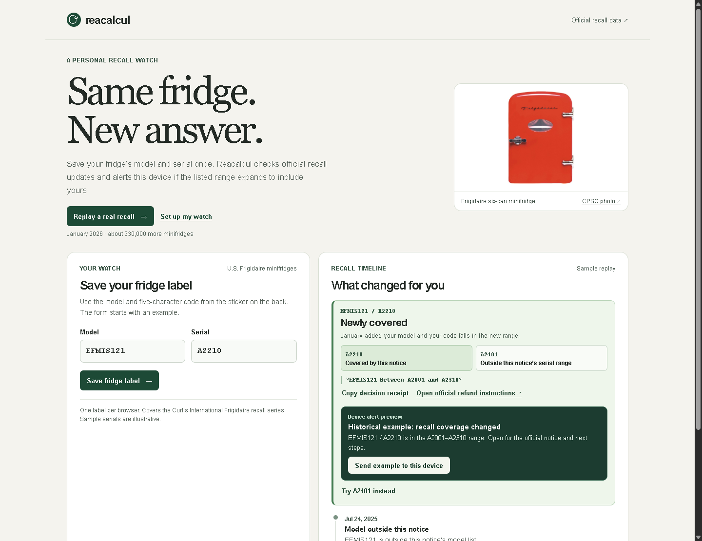

# Judge guide

Run Reacalcul locally to replay two official CPSC notices and see why a recall expansion changes the answer for one serial and leaves the other outside the range. You’ll need Git and Python 3.10 or later. The replay uses the bundled notices and needs no Fly.io account or API keys.

## 1. Start Reacalcul

**macOS or Linux**

```sh
git clone https://github.com/Agozie180/reacalcul.git
cd reacalcul
python3 -m venv .venv
.venv/bin/python -m pip install -r requirements.txt
.venv/bin/python app.py
```

**Windows PowerShell**

```powershell
git clone https://github.com/Agozie180/reacalcul.git
cd reacalcul
py -3 -m venv .venv
.\.venv\Scripts\python.exe -m pip install -r requirements.txt
.\.venv\Scripts\python.exe app.py
```

Leave the terminal open and visit [http://localhost:8080](http://localhost:8080). Press `Ctrl+C` in the terminal when you’re done.

## 2. Check the two serials

1. Click **Replay a real recall**. On model `EFMIS121`, serial `A2210` becomes **Newly covered** in January 2026. The receipt quotes the CPSC range `A2001–A2310` and links to the official refund instructions.
2. Click **Try A2401 instead**. The model stays the same, and the result is **Outside this notice’s serial range**. The example alert is absent for this serial.



## 3. Try the deployed agent

For the Fly Sprite, CPSC connector, and device notification, open the hosted replay and select **Send example to this device**. This sends a labeled example from the historical notice. [Hosted replay](https://reacalcul-b623b.sprites.app/?alert=example) · [Sprite health](https://reacalcul-b623b.sprites.app/healthz)
